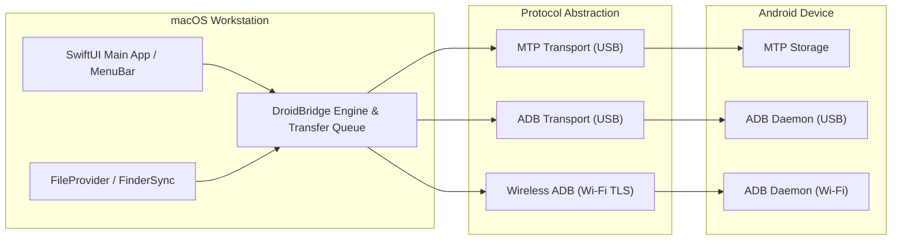

# DroidBridge

> High-Performance macOS Android File Transfer & Finder Integration.

**DroidBridge** is an independent, native macOS application designed to provide seamless bidirectional file management, high-throughput data transfer, and deep Finder integration for Android devices connected via USB or local Wi-Fi.

DroidBridge is engineered as a free, open, and robust alternative to commercial solutions such as MacDroid Pro and discontinued utilities like Google's Android File Transfer.

---

## Key Capabilities

- **Tri-Mode Connectivity:**
  - **USB MTP (Media Transfer Protocol):** Hassle-free plug-and-play browsing of shared storage without enabling Developer Options.
  - **USB ADB (Android Debug Bridge):** High-speed socket streaming over USB with access to granular filesystem attributes and app storage.
  - **Authorized Wireless ADB (Wi-Fi):** Cable-free pairing and two-way transfers via Android 11+ mDNS discovery and TLS pairing.
- **Two-Way File & Directory Transfers:** Complete bidirectional read and write operations for files of any size (including full support for >4 GB files).
- **macOS System & Finder Integration:**
  - Native **FileProvider** extension (`NSFileProviderReplicatedExtension`) allowing Android storage to mount as a drive in Finder.
  - **FinderSync** extension providing contextual menus (*"Send to Android"*) and status badges.
  - Menu Bar status item with quick eject and connection telemetry.
- **Intelligent Transfer Queue:**
  - Asynchronous multi-item queuing with pause, resume, cancel, and priority reordering.
  - Real-time throughput graphs, speed metrics, and dynamic ETA estimation.
  - Automatic post-transfer Android media scanning (`MediaScanner`) so photos and songs appear immediately on the device.
- **Resilient & Fault-Tolerant:** Automatic handling of transient socket drops, device lock screens, and cable pulls with clean state teardown.

---

## Project Structure

```
File_Transfer/
├── docs/                        # Architecture, specs, and test definitions
│   ├── product-spec.md          # Comprehensive product requirements & goals
│   ├── feature-matrix.md        # Competitive benchmark vs MacDroid & OpenMTP
│   ├── architecture.md          # Subsystem design, protocols, and concurrency model
│   ├── investigation-notes.md   # Environmental findings, REA status, and analysis
│   └── acceptance-tests.md      # Test suites, SLAs, and verification scenarios
├── reference/                   # Clean-room specifications, protocol schemas & RFCs
├── evidence/                    # Benchmark traces, protocol captures & test logs
├── notes/                       # Developer notes and architectural decision records (ADRs)
├── src/                         # Swift source code
│   ├── DroidBridgeCore/         # Models, protocols, services, and mock provider
│   │   ├── Models/              # Domain models (StorageItem, DeviceDescriptor, etc.)
│   │   ├── Protocols/           # DeviceTransport, TransferService, DeviceFileSystem
│   │   ├── Services/            # TransferQueueService, ConnectionManager
│   │   └── Mock/                # MockDeviceTransport, MockDeviceDiscoveryService
│   └── DroidBridgeApp/          # Native SwiftUI desktop application
│       └── App/                 # DroidBridgeApp entry point and ContentView
├── tests/                       # Unit and integration test suites
│   ├── DroidBridgeTests/        # XCTest test cases
│   └── DroidBridgeTestRunner/   # Standalone executable test runner
├── Package.swift                # Swift Package Manager manifest
└── README.md                    # Project overview and roadmap
```

---

## Build & Execution Guide

### System Prerequisites
- macOS 15.0 or later (tested on macOS 27.2 Apple Silicon arm64).
- Swift 6.0+ toolchain (Apple Swift 6.4 via Xcode Command Line Tools).

### Build Commands

```bash
# Build all targets (DroidBridgeCore, DroidBridgeApp, DroidBridgeTestRunner)
swift build --disable-sandbox --scratch-path /tmp/droidbridge-build -Xbuild-tools-swiftc -module-cache-path -Xbuild-tools-swiftc /tmp/clang-cache -Xswiftc -module-cache-path -Xswiftc /tmp/clang-cache

# Run the automated test suite (50 assertions across 9 test suites)
swift run --disable-sandbox --scratch-path /tmp/droidbridge-build -Xbuild-tools-swiftc -module-cache-path -Xbuild-tools-swiftc /tmp/clang-cache -Xswiftc -module-cache-path -Xswiftc /tmp/clang-cache DroidBridgeTestRunner

# Launch the SwiftUI macOS Application
swift run --disable-sandbox --scratch-path /tmp/droidbridge-build -Xbuild-tools-swiftc -module-cache-path -Xbuild-tools-swiftc /tmp/clang-cache -Xswiftc -module-cache-path -Xswiftc /tmp/clang-cache DroidBridgeApp
```

---

## Toolkit & Environment Status

- **REA Toolkit (`morluto/rea`):**
  - **Status:** Checked and verified; currently **not installed** in the local environment.
  - **Documented Setup:** Verified upstream setup requirements (`npx rea-agents setup`). Node.js (v24.14.1) is available on the host. In keeping with developer safety protocols, the tool has not been automatically installed into global agent configurations.
- **Reference Application Assessment (`MacDroid.app`):**
  - Found installed at `/Applications/MacDroid.app` (Mac App Store edition).
  - Inspected strictly at the metadata/bundle level to understand modern macOS integration patterns (FileProvider + FinderSync + libmtp + ADB).
  - **Strict Clean-Room Policy:** No proprietary code, license validation mechanisms, or copyrighted assets have been decompiled, copied, or bypassed.

---

## Architectural Principles



For detailed architectural schematics, see [`docs/architecture.md`](file:///Volumes/New%20Volume%20(E)/Coding/projects/File_Transfer/docs/architecture.md).

---

## Documentation Index

1. [Product Specification](file:///Volumes/New%20Volume%20(E)/Coding/projects/File_Transfer/docs/product-spec.md)
2. [Feature Comparison Matrix](file:///Volumes/New%20Volume%20(E)/Coding/projects/File_Transfer/docs/feature-matrix.md)
3. [Architecture & System Design](file:///Volumes/New%20Volume%20(E)/Coding/projects/File_Transfer/docs/architecture.md)
4. [Investigation & Environmental Notes](file:///Volumes/New%20Volume%20(E)/Coding/projects/File_Transfer/docs/investigation-notes.md)
5. [Acceptance Test Plan](file:///Volumes/New%20Volume%20(E)/Coding/projects/File_Transfer/docs/acceptance-tests.md)

---

## Development Milestones

- [x] **Milestone 0: Workspace Discovery & Documentation Baseline**
  - Inspection of workspace, toolkit verification, clean-room investigation notes.
  - Architecture blueprint, product spec, feature matrix, and acceptance tests.
- [x] **Milestone 1: Mock Harness & Core Transport Protocol Interfaces**
  - Abstract protocols: `DeviceTransport`, `DeviceFileSystem`, `TransferService`, `TransferQueue`, `ConnectionManagerProtocol`, `DeviceDiscoveryService`.
  - Concrete mock provider (`MockDeviceTransport`) with isolated temporary filesystem and seeded Android storage (`/sdcard`, `DCIM`, `Download`, `Music`, `Documents`).
  - Security hardening: Path traversal validation (`..` and escaping checks) and conflict resolution policies.
  - `TransferQueueService`: Actor-isolated job queue with state transitions and progress reporting.
  - `DroidBridgeApp`: Native SwiftUI application with simulated device explorer and Dev Mock toggle.
  - Automated test harness (`DroidBridgeTestRunner`): 50/50 assertions passing across 9 test suites.
- [ ] **Milestone 2: ADB USB & Wireless Protocol Implementation**
  - Socket streaming and ADB `SYNC` command handler (`STAT`, `LIST`, `SEND`, `RECV`).
- [ ] **Milestone 3: MTP USB Protocol Integration**
  - Integration with `libmtp` / USB bulk endpoints with strict actor-based concurrency.
- [ ] **Milestone 4: Transfer Queue & Scheduler**
  - Progress calculation, speed monitoring, pause/resume, and collision resolution.
- [ ] **Milestone 5: macOS UI & Finder Integration**
  - SwiftUI desktop browser, Menu Bar extra, FinderSync and FileProvider extensions.

---

## Ethical & Clean-Room Standards

DroidBridge is developed under strict clean-room software engineering standards. All protocol communications (MTP and ADB) rely exclusively on publicly documented standards (ISO 15740 / PTP, AOSP Android Open Source Project specifications) and standard open-source libraries (`libusb`, `libmtp`). No proprietary code, trade secrets, or licensing mechanisms from commercial tools are incorporated.
