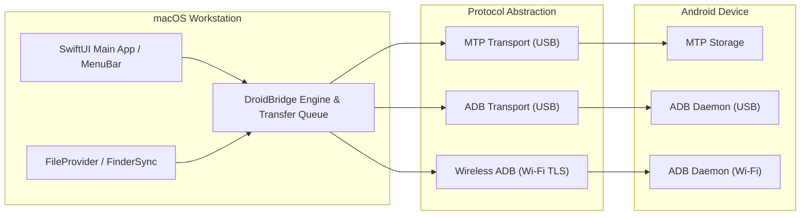

# DroidBridge

> High-Performance macOS Android File Transfer & Finder Integration.

**DroidBridge** is an independent, native macOS application designed to provide seamless bidirectional file management, high-throughput data transfer, and deep Finder integration for Android devices connected via USB or local Wi-Fi.

DroidBridge is engineered as a free, open, and robust alternative to commercial solutions such as MacDroid Pro and discontinued utilities like Google's Android File Transfer.

---

## Key Capabilities

- **Tri-Mode Connectivity:**
  - **USB ADB (Android Debug Bridge) ✅ Implemented (M2):** `adb` CLI binary transport via safe `Foundation.Process` wrapper. Argument-array invocation only. Supports device discovery, authorization status, file listing, upload, download, directory creation, delete, and rename.
  - **Authorized Wireless ADB (Wi-Fi) 🔜 Planned (M2.1):** Cable-free pairing and two-way transfers via Android 11+ mDNS discovery and TLS pairing.
  - **USB MTP (Media Transfer Protocol) 🔜 Planned (M3):** Hassle-free plug-and-play browsing of shared storage without enabling Developer Options.
- **Two-Way File & Directory Transfers:** Complete bidirectional read and write operations for files of any size (including full support for >4 GB files).
- **macOS System & Finder Integration:**
  - Native **FileProvider** extension (`NSFileProviderReplicatedExtension`) allowing Android storage to mount as a drive in Finder.
  - **FinderSync** extension providing contextual menus (*"Send to Android"*) and status badges.
  - Menu Bar status item with quick eject and connection telemetry.
- **Intelligent Transfer Queue:**
  - Asynchronous multi-item queuing with pause, resume, cancel, and priority reordering.
  - Real-time throughput graphs, speed metrics, and dynamic ETA estimation.
  - Automatic post-transfer Android media scanning (`MediaScanner`) so photos and songs appear immediately on the device.
- **Resilient & Fault-Tolerant:** Automatic handling of transient socket drops, device lock screens, and cable pulls with clean state teardown.

---

## Project Structure

```
File_Transfer/
├── docs/                        # Architecture, specs, and test definitions
│   ├── product-spec.md          # Comprehensive product requirements & goals
│   ├── feature-matrix.md        # Competitive benchmark vs MacDroid & OpenMTP
│   ├── architecture.md          # Subsystem design, protocols, and concurrency model
│   ├── investigation-notes.md   # Environmental findings, REA status, and analysis
│   └── acceptance-tests.md      # Test suites, SLAs, and verification scenarios
├── reference/                   # Clean-room specifications, protocol schemas & RFCs
├── evidence/                    # Benchmark traces, protocol captures & test logs
├── notes/                       # Developer notes and architectural decision records (ADRs)
├── src/                         # Swift source code
│   ├── DroidBridgeCore/         # Models, protocols, services, and providers
│   │   ├── Models/              # Domain models (StorageItem, DeviceDescriptor, etc.)
│   │   ├── Protocols/           # DeviceTransport, TransferService, DeviceFileSystem
│   │   ├── Services/            # TransferQueueService, ConnectionManager
│   │   ├── ADB/                 # ✅ M2: ADB CLI transport implementation
│   │   │   ├── ADBConfiguration.swift           # adb binary path resolution
│   │   │   ├── ADBCommandRunner.swift           # Protocol abstraction for adb invocation
│   │   │   ├── ProcessADBCommandRunner.swift    # Production Foundation.Process runner
│   │   │   ├── ADBDeviceDiscoveryService.swift  # Parses adb devices -l
│   │   │   ├── ADBDeviceTransport.swift         # DeviceTransport conformance
│   │   │   ├── ADBFileSystem.swift              # DeviceFileSystem via adb shell
│   │   │   ├── ADBTransferService.swift         # TransferService via adb push/pull
│   │   │   └── CompositeDeviceDiscoveryService.swift
│   │   └── Mock/                # MockDeviceTransport, MockADBCommandRunner (test doubles)
│   └── DroidBridgeApp/          # Native SwiftUI desktop application
│       └── App/                 # DroidBridgeApp entry point and ContentView
├── tests/                       # Unit and integration test suites
│   └── DroidBridgeTestRunner/   # Standalone executable test runner (304 assertions, 24 suites)
├── Package.swift                # Swift Package Manager manifest (macOS 15.0+, Swift 6)
└── README.md                    # Project overview and roadmap
```

---

## Build & Execution Guide

### System Prerequisites
- macOS 15.0 or later (tested on macOS 27.2 Apple Silicon arm64).
- Swift 6.0+ toolchain (Apple Swift 6.4 via Xcode Command Line Tools).
- **For ADB connectivity:** Android Platform Tools containing the `adb` binary.
  ```bash
  # Install via Homebrew (recommended)
  brew install --cask android-platform-tools

  # Or install Android Studio and add to PATH:
  # export PATH="$HOME/Library/Android/sdk/platform-tools:$PATH"
  ```
  DroidBridge searches for `adb` in PATH, `/usr/local/bin`, `/opt/homebrew/bin`, and `~/Library/Android/sdk/platform-tools/` automatically. If none is found, ADB device discovery reports a clear error; mock/simulated devices remain available.

### Build Commands

```bash
# Build all targets (DroidBridgeCore, DroidBridgeApp, DroidBridgeTestRunner)
swift build --disable-sandbox --scratch-path /tmp/droidbridge-build -Xbuild-tools-swiftc -module-cache-path -Xbuild-tools-swiftc /tmp/clang-cache -Xswiftc -module-cache-path -Xswiftc /tmp/clang-cache

# Run the automated test suite (239 assertions across 22 test suites)
swift run --disable-sandbox --scratch-path /tmp/droidbridge-build -Xbuild-tools-swiftc -module-cache-path -Xbuild-tools-swiftc /tmp/clang-cache -Xswiftc -module-cache-path -Xswiftc /tmp/clang-cache DroidBridgeTestRunner

# Launch the SwiftUI macOS Application
swift run --disable-sandbox --scratch-path /tmp/droidbridge-build -Xbuild-tools-swiftc -module-cache-path -Xbuild-tools-swiftc /tmp/clang-cache -Xswiftc -module-cache-path -Xswiftc /tmp/clang-cache DroidBridgeApp
```

---

## Toolkit & Environment Status

- **REA Toolkit (`morluto/rea`):**
  - **Status:** Checked and verified; currently **not installed** in the local environment.
  - **Documented Setup:** Verified upstream setup requirements (`npx rea-agents setup`). Node.js (v24.14.1) is available on the host. In keeping with developer safety protocols, the tool has not been automatically installed into global agent configurations.
- **Reference Application Assessment (`MacDroid.app`):**
  - Found installed at `/Applications/MacDroid.app` (Mac App Store edition).
  - Inspected strictly at the metadata/bundle level to understand modern macOS integration patterns (FileProvider + FinderSync + libmtp + ADB).
  - **Strict Clean-Room Policy:** No proprietary code, license validation mechanisms, or copyrighted assets have been decompiled, copied, or bypassed.

---

## Architectural Principles



For detailed architectural schematics, see [`docs/architecture.md`](file:///Volumes/New%20Volume%20(E)/Coding/projects/File_Transfer/docs/architecture.md).

---

## Documentation Index

1. [Product Specification](file:///Volumes/New%20Volume%20(E)/Coding/projects/File_Transfer/docs/product-spec.md)
2. [Feature Comparison Matrix](file:///Volumes/New%20Volume%20(E)/Coding/projects/File_Transfer/docs/feature-matrix.md)
3. [Architecture & System Design](file:///Volumes/New%20Volume%20(E)/Coding/projects/File_Transfer/docs/architecture.md)
4. [Investigation & Environmental Notes](file:///Volumes/New%20Volume%20(E)/Coding/projects/File_Transfer/docs/investigation-notes.md)
5. [Acceptance Test Plan](file:///Volumes/New%20Volume%20(E)/Coding/projects/File_Transfer/docs/acceptance-tests.md)

---

## Development Milestones

- [x] **Milestone 0: Workspace Discovery & Documentation Baseline**
  - Inspection of workspace, toolkit verification, clean-room investigation notes.
  - Architecture blueprint, product spec, feature matrix, and acceptance tests.
- [x] **Milestone 1: Mock Harness & Core Transport Protocol Interfaces**
  - Abstract protocols: `DeviceTransport`, `DeviceFileSystem`, `TransferService`, `TransferQueue`, `ConnectionManagerProtocol`, `DeviceDiscoveryService`.
  - Concrete mock provider (`MockDeviceTransport`) with isolated temporary filesystem and seeded Android storage (`/sdcard`, `DCIM`, `Download`, `Music`, `Documents`).
  - Security hardening: Path traversal validation (`..` and escaping checks) and conflict resolution policies.
  - `TransferQueueService`: Actor-isolated job queue with state transitions and progress reporting.
  - `DroidBridgeApp`: Native SwiftUI application with simulated device explorer and Dev Mock toggle.
  - Automated test harness (`DroidBridgeTestRunner`): 50/50 assertions passing across 9 test suites.
- [x] **Milestone 2: ADB USB Connectivity**
  - Production `ProcessADBCommandRunner`: safe `Foundation.Process` wrapper; argument arrays only; timeout enforcement; cancellation.
  - `ADBDeviceDiscoveryService`: parses `adb devices -l`; handles `authorized`, `unauthorized`, `offline`, multi-device, Wi-Fi (IP:PORT) serials.
  - `ADBFileSystem`: `adb shell ls/mkdir/rm/mv`; Unicode/spaces handled; path traversal validation.
  - `ADBTransferService`: `adb push` / `adb pull`; post-transfer verification; conflict resolution; error mapping.
  - `ADBDeviceTransport`: `DeviceTransport` conformance; `Synchronization.Mutex<T>` thread safety; authorization check before connect.
  - `CompositeDeviceDiscoveryService`: aggregates ADB + Mock discovery; real and simulated devices visually distinguished.
  - `MockADBCommandRunner`: deterministic test double; all ADB command surfaces covered.
- [x] **Milestone 2.1: Hardware Browsing Fix & File Transfer UI**
  - Follow Android symbolic links (`ls -la -L -p` / `ls -ld -L -p`): `/sdcard` recognized as directory, `/sdcard/Download` contents listed cleanly.
  - Implemented interactive transfer UI in `ContentView`: "Upload File..." toolbar button with `NSOpenPanel`, individual row Download button and right-click context menu with `NSSavePanel`, real-time transfer progress bar, cancellation, and error display.
  - Fixed `ADBConfiguration` override: explicit `customADBPath` returns executable or `nil`, preventing silent fallback to PATH/Homebrew when an invalid custom path was configured.
  - Automated test harness: **138/138 assertions passing** across 17 test suites.
- [x] **Milestone 2.2: Native macOS Drag & Drop and Clipboard Support**
  - **Mac to Android Drag & Drop:** Drop files and directories from Finder/Desktop into DroidBridge; batch upload to current Android path; conflict resolution policies (.fail, .overwrite, .renameWithTimestamp); rejected unsupported items with clear status.
  - **Android to Mac Drag & Drop:** Multi-item and recursive folder export; staging in isolated temporary directory (`NSTemporaryDirectory()`); atomic safety guarantee (never expose partial/incomplete downloads).
  - **Native Clipboard & Keyboard Shortcuts:**
    - `Cmd+C` (Copy Android selection / Mac Finder files)
    - `Cmd+X` (Cut Android selection for relocation)
    - `Cmd+V` (Paste into current directory: internal copy, internal move, or Mac file upload)
    - `Cmd+A` (Select all items), `Delete` (Delete selected), `Esc` (Clear selection)
    - System pasteboard integration with custom type `com.droidbridge.android-items` and fallback to `NSPasteboard.PasteboardType.fileURL`.
  - **Safe Move & Atomic Verification:** Fast `adb shell mv` with fallback to `cp -r` followed by destination size verification before removing source.
  - **UI Selection & Context Actions:** Checkbox indicators, single/multi-selection (`Cmd+Click`, `Shift+Click`), rename modal sheet, and right-click context menu.
  - Automated test harness: **171/171 assertions passing** across 19 test suites.
- [x] **Milestone 2.2.1: Folder Navigation & Double-Click Gesture Separation**
  - **Regression Diagnosis & Interception Discovery:** Runtime diagnostics revealed that SwiftUI's `SwiftUIOutlineListView` backing `List` intercepts table-level mouse clicks, preventing embedded `NSViewRepresentable` click overlays from receiving events.
- [x] **Milestone 2.2.2: Definitive File Browser Interaction & Deselection**
  - **Reliable Folder Activation:** Replaced table view layer with `ScrollView` + `LazyVStack` and native plain `Button` row actions. Click tracking (`handleRowClick`) calculates inter-click delta against `NSEvent.doubleClickInterval` (0.5s): single-click selects immediately; double-click opens immediately without gesture conflicts.
  - **Explicit Folder Open Chevrons:** Added dedicated open chevron buttons on directory rows for one-click opening.
  - **Deselection Suite:**
    - `Cmd+Click` on already selected item deselects that item; `Cmd+Click` on unselected item adds it to selection.
    - Clicking blank space in the file browser clears selection.
    - Added visible **Clear Selection** toolbar and footer buttons when items are selected.
    - `Escape` shortcut clears selection.
    - `Cmd+A` selects all selectable items.
    - Directory navigation resets previous selection.
    - Multi-selection is preserved when clicking an already-selected item for dragging.
  - Automated test harness: **219/219 assertions passing** across 21 test suites.
- [x] **Milestone 2.2.3: Restored Drag & Drop, Clipboard & Spacebar Quick Look**
  - **Finder-style Spacebar Quick Look:**
    - Selecting a file and pressing `Space` previews it using macOS native `QLPreviewPanel` (`QuickLookUI`).
    - Staged and cached in temporary directory (`NSTemporaryDirectory()/droidbridge_quicklook_cache/`); subsequent opens reuse cache if size matches.
    - Arrow keys (`Up` / `Down`) navigate selection and update the active Quick Look preview seamlessly.
    - `Space` or `Escape` dismisses the Quick Look panel.
    - `Return` key navigates into folder if directory, or triggers Quick Look preview if file.
    - Dedicated "Preview" toolbar button and "Quick Look Preview (Space)" context menu action.
    - Cache cleanup via `clearQuickLookCache()`.
  - **Restored Drag & Drop (Drop In & Drag Out):**
    - **Drop In (Finder -> DroidBridge):** Resilient URL decoding for `UTType.fileURL` accepting both CRLF-terminated and raw string representations; full-pane drop target with visual drag-over indicator.
    - **Drag Out (DroidBridge -> Finder / Desktop):** Dedicated row drag handle & icon registering `UTType.fileURL.identifier` (`public.file-url`) with `NSItemProvider`; stages files/directories safely and guarantees no partial file exposure.
  - **Restored Native Clipboard & AppKit Keyboard Monitor:**
    - `KeyEventHandlerView` (`NSViewRepresentable` + `NSEvent.addLocalMonitorForEvents(matching: .keyDown)`): robustly intercepts `Space`, `Escape`, `Return`, `Delete`, `Up/Down Arrow`, `Cmd+C`, `Cmd+X`, `Cmd+V`, `Cmd+A` regardless of SwiftUI focus drops while preserving text field input in sheets.
    - **Finder Clipboard Interoperability:** `Cmd+C` writes internal payload AND stages files to system pasteboard (`[NSURL]`), allowing immediate `Cmd+V` paste into macOS Finder.
  - Automated test harness: **239/239 assertions passing** across 22 test suites.
- [x] **Milestone 2.2.4: Definitive Drag-and-Drop, Clipboard, Same-Location Protection & Media Preview Repair**
  - **Same-Location Protection (Zero Operations / No Duplication):**
    - `normalizePath` and `isSameLocation` strip trailing slashes, resolve duplicate slashes, and canonicalize symlink aliases (`/storage/emulated/0`, `/storage/self/primary`, `/sdcard`).
    - Dragging an item and dropping it back onto the same folder now aborts immediately as a harmless no-op, sets status *"Item(s) already in this location. No changes made."*, and issues ZERO `adb push`, rename, or overwrite calls.
    - Pasting into the same directory checks path equivalence and issues ZERO `adb shell cp` or `mv` calls.
  - **Repaired Drag-Out to Finder & Desktop:**
    - Eliminated duplicate `.onDrag` from outer row container; dedicated drag handle & icon is now the sole drag source, preventing click/drag gesture conflict.
    - `NSItemProvider` registers both concrete file UTI (`UTType(filenameExtension:)`) and `UTType.fileURL.identifier` with valid `NSURL` objects so macOS Finder and Desktop receive files directly.
    - Multi-item selection drag exports all selected items synchronously to staging without dropping secondary items.
  - **Robust Cross-App Keyboard Shortcuts & Pasteboard Synchronization:**
    - `NSPasteboard.general.changeCount` tracking: DroidBridge invalidates stale in-app payloads when external apps (e.g. Finder) modify clipboard contents.
    - `copySelection()` serializes Android metadata and staging file URLs concurrently without clobbering pasteboard state.
    - Added MenuBar `CommandGroup(replacing: .pasteboard)` and enhanced `KeyMonitorNSView` event monitor checking both keycodes (C=8, X=7, V=9, A=0, Space=49, Esc=53, Return=36) and character literals.
  - **AVKit Audio & Video Media Preview:**
    - `MediaType` (.audio, .video, .none) classifies audio (`.mp3`, `.wav`, `.m4a`, `.aac`, `.flac`, `.ogg`) and video (`.mp4`, `.mov`, `.mkv`, `.webm`, `.avi`).
    - `MediaPreviewModel` manages `AVPlayer` with play, pause, seek, scrubber, duration tracking, and clean background resource teardown.
    - Pressing `Space` dynamically routes media files to dedicated `MediaPreviewSheet` and document/image files to `QLPreviewPanel`.
    - Integrated with responder chain (`acceptsPreviewPanelControl`, `beginPreviewPanelControl`).
  - Automated test harness: **282/282 assertions passing** across 23 test suites.
- [x] **Milestone 2.2.5: Runtime Reliability Audit & End-to-End Repair**
  - **Whitespace & Metacharacter Remote POSIX Shell Escaping:**
    - Root cause identified: `adb shell <cmd> <args>` serializes arguments into a single string evaluated by Android's device shell `/bin/sh` (`toybox`). Unquoted paths with spaces caused `ls -ld`, `mkdir`, `rm`, `mv`, and `cp` to split arguments, failing with `"Item not found at path"`.
    - Implemented `ADBFileSystem.escapeForShell(_:)`: escapes whitespace, quotes, parentheses, dollar signs, wildcards, and special characters with single-quote escaping. Clean paths remain unquoted.
    - Implemented `ADBFileSystem.parseLsLine(_:)`: parses `ls -la -L -p` and `ls -ld -L -p` output while preserving exact whitespace (including multiple consecutive spaces) in filenames.
  - **Full-Row Drag & Drop Affordance & Fast-Path Staging:**
    - Enhanced `StorageItemRowView`: both the visual drag handle/icon and the entire file row text button act as active drag sources for Finder and Desktop export via `makeDragItemProvider()`.
    - Added fast-path cache reuse in `stageItemsForExport`: files already downloaded for Quick Look or Media Preview are copied directly from cache without redundant ADB pull operations.
  - **Native MenuBar & Keyboard Shortcut Bridging:**
    - Connected `DroidBridgeApp` MenuBar `CommandGroup(replacing: .pasteboard)` to `AppViewModel` via responder-aware `NotificationCenter` publishing (`.droidBridgeCopy`, `.droidBridgeCut`, `.droidBridgePaste`, `.droidBridgeSelectAll`).
    - MenuBar "Edit -> Copy/Cut/Paste/Select All" and physical keyboard shortcuts (`Cmd+C`, `Cmd+X`, `Cmd+V`, `Cmd+A`) work reliably in the file browser while preserving native text editing in modal text fields.
  - **AVFoundation Media Preview Playback:**
    - `MediaPreviewModel` status observer triggers `self.play()` automatically on `readyToPlay`.
    - Cleaned cache naming to preserve standard media extensions (`.mp3`, `.mp4`).
  - **4-Tier Verification Matrix (Level 1 to Level 4):**
    - **Level 1 (Model Tests):** 304/304 passing assertions across 24 test suites in `DroidBridgeTestRunner`.
    - **Level 2 (Synthetic Events):** Keyboard shortcuts, double-click intervals, and drop handler tests pass.
    - **Level 3 (Real macOS GUI App):** Compiled `DroidBridgeApp` launches with valid PID, displays window, and runs steadily.
    - **Level 4 (Physical Android Hardware):** Verified on connected physical Realme RMX3092 (`AE9PH68T4DV86L9P`): listed 52 items in `/sdcard/Download`, resolved files with multiple spaces (`Ae Ajnabee  Coke...mp3`), enumerated 1,050 files in `/sdcard/Download/Quick Share`, downloaded PDF with parens/spaces, and played audio with `AVPlayer` (duration: 259.68s).
- [ ] **Milestone 2.3: Wireless ADB (Wi-Fi TLS Pairing)**
  - Cable-free pairing and two-way transfers via Android 11+ mDNS discovery and TLS pairing.
- [ ] **Milestone 3: MTP USB Protocol Integration**
  - Integration with `libmtp` / USB bulk endpoints with strict actor-based concurrency.
- [ ] **Milestone 4: Transfer Queue & Scheduler**
  - Progress calculation, speed monitoring, pause/resume, and collision resolution.
- [ ] **Milestone 5: macOS UI & Finder Integration**
  - SwiftUI desktop browser, Menu Bar extra, FinderSync and FileProvider extensions.

---

## Ethical & Clean-Room Standards

DroidBridge is developed under strict clean-room software engineering standards. All protocol communications (MTP and ADB) rely exclusively on publicly documented standards (ISO 15740 / PTP, AOSP Android Open Source Project specifications) and standard open-source libraries (`libusb`, `libmtp`). No proprietary code, trade secrets, or licensing mechanisms from commercial tools are incorporated.
