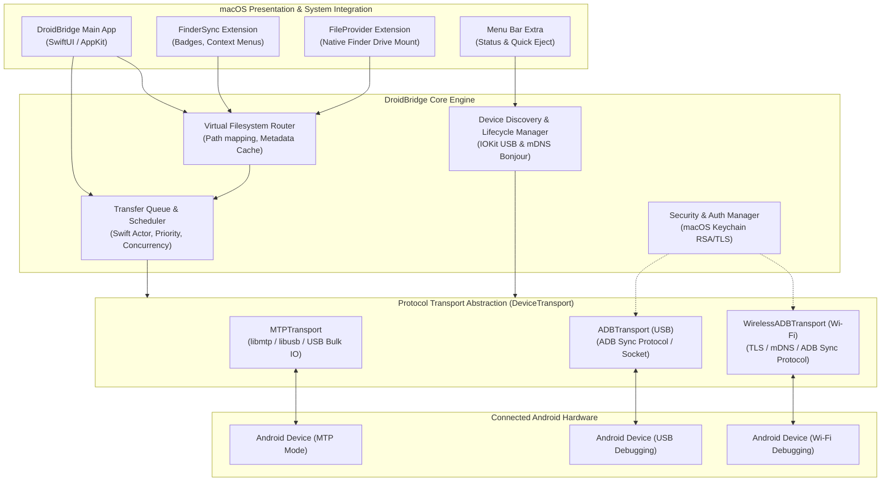

# DroidBridge Architecture & Engineering Design

## 1. Architectural Overview

DroidBridge is engineered as a modular, layered macOS application built in Swift. It isolates hardware communication and low-level protocol engines from high-level presentation and macOS system extensions.

### 1.1 High-Level Architecture Diagram



---

## 2. Subsystem Breakdown

### 2.1 UI & Presentation Layer
- **`DroidBridgeApp` (SwiftUI):** Modern multi-window macOS desktop application providing:
  - Dual-pane or single-pane directory browser.
  - Transfer Queue monitoring drawer (progress bars, throughput speed curves, ETA).
  - Device connection switcher and setup wizards (USB MTP setup guide, USB ADB authorization guide, Wireless pairing dialog).
- **`MenuBarController` (AppKit):** Lightweight agent in the macOS menu bar providing instant status of connected devices, active transfer count, and a safe one-click "Eject / Unmount" button.

### 2.2 macOS System Integration Layer
- **`FinderSyncExtension` (`FIFinderSync`):**
  - Registers the mounted Android storage path with macOS Finder.
  - Renders status badges on files/folders.
  - Injects contextual menu items: *"Copy to Android Device"*, *"Reveal in DroidBridge"*.
- **`FileProviderExtension` (`NSFileProviderReplicatedExtension`):**
  - Maps Android storage into Apple's native FileProvider hierarchy.
  - Translates Finder read/write intents into asynchronous `DeviceTransport` queries.
  - Implements on-demand item materialization and pagination.

### 2.3 Core Engine & State Management
- **`DeviceRegistry` (Actor):**
  - Monitors USB hotplug events via IOKit (`IOServiceAddMatchingNotification` for USB Device classes `0x06` Image/PTP/MTP and `0xFF` Vendor Specific/ADB).
  - Listens on local network for mDNS services (`_adb-tls-connect._tcp` and `_adb-tls-pairing._tcp`).
  - Maintains connected device lifecycle (Connected, Authenticating, Ready, Disconnected).
- **`TransferQueue` (Actor):**
  - Manages active, queued, paused, completed, and failed transfer jobs.
  - Controls concurrency limits (e.g., MTP transport allows exactly 1 active I/O operation per device; ADB transport allows concurrent multiplexed streams).
  - Implements token-bucket rate limiting (optional) and real-time moving-average speed calculation.
- **`VFSRouter`:**
  - Standardizes cross-platform path differences (POSIX forward slash `/` vs MTP Object IDs).
  - In-memory metadata and directory cache with configurable TTL (Time-To-Live) to prevent redundant MTP enumerations.

---

## 3. Protocol Transport Layer (`DeviceTransport`)

All protocol implementations conform to the unified Swift protocol:

```swift
public protocol DeviceTransport: AnyObject, Sendable {
    var deviceID: String { get }
    var connectionType: ConnectionType { get } // .usbMTP, .usbADB, .wirelessADB
    
    func connect() async throws
    func disconnect() async
    func listDirectory(at path: String) async throws -> [FileSystemItem]
    func createDirectory(at path: String, name: String) async throws -> FileSystemItem
    func deleteItem(at path: String, isDirectory: Bool) async throws
    func renameItem(at path: String, newName: String) async throws -> FileSystemItem
    func download(from remotePath: String, to localURL: URL, progress: @Sendable (TransferProgress) -> Void) async throws
    func upload(from localURL: URL, to remotePath: String, progress: @Sendable (TransferProgress) -> Void) async throws
}
```

### 3.1 MTP Transport (`MTPTransport`)
- Communicates directly over USB bulk endpoints via `libmtp` / `libusb`.
- Translates filenames into MTP 32-bit Object Handles.
- Enforces strict mutual exclusion via Swift Actor isolation because MTP protocol transactions are non-reentrant.
- Triggers `android.hardware.action.MEDIA_SCANNER_SCAN_FILE` or MTP sendObjectComplete so media shows up immediately in Android apps.

### 3.2 ADB Transport (`ADBTransport`)
- Connects to ADB server daemon on local loopback TCP port.
- Negotiates `transport:<serial>` to lock communication to the specific Android target.
- Uses the `SYNC` service stream:
  - `SEND`: Sends file data in 64 KB chunks followed by `DONE` with file timestamp.
  - `RECV`: Pulls file data stream until `DONE` packet is received.
  - `LIST`: Efficiently streams directory entries in binary format (`DENT` packets).

### 3.3 Wireless ADB Transport (`WirelessADBTransport`)
- Implements pairing handshake via TLS (Android 11+ pairing server).
- Authenticates with host RSA key stored in the macOS Keychain.
- Operates over Wi-Fi TCP socket directly into the ADB server or embedded transport.

---

## 4. Concurrency, Memory & Streaming Model

### 4.1 Swift Concurrency & Actors
- State mutation for the transfer queue and device sessions is strictly confined to Swift `actor` boundaries (`TransferQueueActor`, `DeviceSessionActor`).
- Eliminates data races and locks.

### 4.2 Stream-Based I/O & Bounded Memory
- File uploads and downloads stream chunks directly between disk and socket/USB endpoints using Swift `AsyncSequence` and Foundation `FileHandle` / `AsyncBytes`.
- Chunk size is dynamically tuned:
  - Default: 64 KB for MTP to avoid buffer overrun on older Android kernels.
  - Default: 256 KB – 1 MB for ADB USB 3.0 to maximize throughput.
- Maximum RAM consumption during a 100 GB transfer remains stable (< 80 MB).

---

## 5. Security, Sandbox & Entitlements

DroidBridge adheres to macOS App Sandbox guidelines:

- **Entitlements Required:**
  - `com.apple.security.app-sandbox` — Sandbox isolation.
  - `com.apple.security.files.user-selected.read-write` — User selected file access via Finder dialogs and drag-and-drop.
  - `com.apple.security.device.usb` — Permission to communicate with USB devices.
  - `com.apple.security.network.client` — Outbound TCP network connections (for ADB localhost socket and Wi-Fi ADB).
  - `com.apple.security.network.server` — Inbound listener for wireless mDNS / pairing callbacks.
  - `com.apple.security.application-groups` — Shared App Group for IPC between main app, FinderSync, and FileProvider extensions.
- **Keychain Storage:**
  - Host RSA private keys (`adbkey`) are stored securely in macOS Keychain Services with access controls restricted to DroidBridge.
