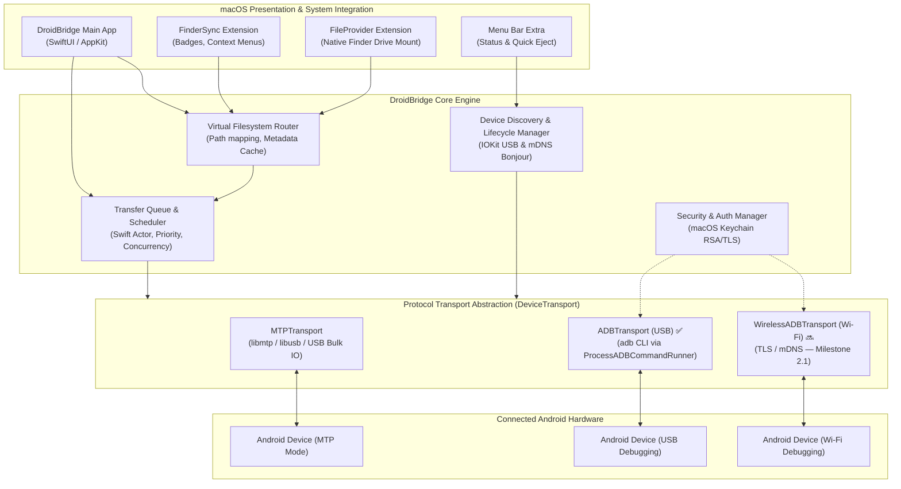

# DroidBridge Architecture & Engineering Design

## 1. Architectural Overview

DroidBridge is engineered as a modular, layered macOS application built in Swift. It isolates hardware communication and low-level protocol engines from high-level presentation and macOS system extensions.

### 1.1 High-Level Architecture Diagram



---

## 2. Subsystem Breakdown

### 2.1 UI & Presentation Layer
- **`DroidBridgeApp` (SwiftUI):** Modern multi-window macOS desktop application providing:
  - Dual-pane or single-pane directory browser.
  - Transfer Queue monitoring drawer (progress bars, throughput speed curves, ETA).
  - Device connection switcher and setup wizards (USB MTP setup guide, USB ADB authorization guide, Wireless pairing dialog).
- **`MenuBarController` (AppKit):** Lightweight agent in the macOS menu bar providing instant status of connected devices, active transfer count, and a safe one-click "Eject / Unmount" button.

### 2.2 macOS System Integration Layer
- **`FinderSyncExtension` (`FIFinderSync`):**
  - Registers the mounted Android storage path with macOS Finder.
  - Renders status badges on files/folders.
  - Injects contextual menu items: *"Copy to Android Device"*, *"Reveal in DroidBridge"*.
- **`FileProviderExtension` (`NSFileProviderReplicatedExtension`):**
  - Maps Android storage into Apple's native FileProvider hierarchy.
  - Translates Finder read/write intents into asynchronous `DeviceTransport` queries.
  - Implements on-demand item materialization and pagination.

### 2.3 Core Engine & State Management

#### Milestone 1 — Implemented ✅

- **`ConnectionManager` (Actor):**
  - Dependency-injection root for the transport layer.
  - Accepts an optional `ADBCommandRunner` for testability (production: `ProcessADBCommandRunner`; tests: `MockADBCommandRunner`).
  - Dispatches to `ADBDeviceTransport` for `.usbADB` devices and `MockDeviceTransport` for mock devices.
  - Maintains per-device transport instances and active connection state.
- **`TransferQueueService` (Actor):**
  - Manages active, queued, paused, completed, and failed transfer jobs.
  - Enforces concurrency limit (1 active transfer per device by default).
  - Reports real-time `TransferProgress` (bytes transferred, total size, speed, ETA).
  - State machine: `.queued` → `.inProgress` → `.completed` / `.failed` / `.cancelled`.
- **`DeviceDiscoveryService` (Protocol):**
  - `MockDeviceDiscoveryService` — emits pre-seeded Android device descriptors for UI/unit testing.
  - `ADBDeviceDiscoveryService` — calls `adb devices -l` and parses the output.
  - `CompositeDeviceDiscoveryService` — aggregates both; results are tagged by source.

#### Milestone 2.2 — Implemented ✅

- **Native macOS Drag & Drop Architecture:**
  - **Mac to Android (`onDrop`):** Handles `NSItemProvider` instances conforming to `UTType.fileURL`. Extracts local file and folder paths, performs batch upload to the active Android directory using `TransferOptions` and user-configured `ConflictResolutionPolicy` (`.fail`, `.overwrite`, `.renameWithTimestamp`), and rejects unsupported or invalid items with immediate status notifications.
  - **Android to Mac (`onDrag` & Staging):** Uses `NSItemProvider(contentsOf:)` pointing to a securely staged copy. When dragging begins, `stageItemsForExport` downloads the requested items into an isolated session directory (`NSTemporaryDirectory()/droidbridge_export_<UUID>/`). On any error or cancellation, the staging directory is cleaned up immediately, ensuring partially downloaded files are never exposed to Finder or the macOS Desktop.
- **Native macOS Clipboard System (`NSPasteboard`):**
  - Custom pasteboard UTType: `com.droidbridge.android-items`.
  - Serializes `AndroidClipboardPayload` containing `operation` (`.copy` vs `.cut`), source device serial, current directory, and an array of `ClipboardItem` objects.
  - Also populates file URLs (`NSPasteboard.PasteboardType.fileURL`) for interoperability with macOS Finder.
  - Intercepts `Cmd+C` (Copy), `Cmd+X` (Cut), `Cmd+V` (Paste), `Cmd+A` (Select All), `Delete` (Delete Selected), and `Escape` (Clear Selection).
  - Handles three paste routes:
    1. **Mac Finder → Android:** Reads file URLs from pasteboard and streams them into the current Android directory via `ADBTransferService`.
    2. **Android → Android Copy:** Dispatches `adb shell cp -r` directly on the device.
    3. **Android → Android Move (Cut):** Dispatches `moveItem(from:to:)` using fast-path `mv` with copy-verify-delete fallback, and clears the cut clipboard upon completion.
- **Safe Move & Integrity Verification:**
  - `moveItem(from:to:)` attempts fast atomic rename via `adb shell mv`.
  - If cross-filesystem or permission errors occur, falls back to `copyItem(from:to:)` (`cp -r`), verifies that destination exists and has matching file size, and only then deletes the source via `deleteItem(at:)`.

#### Milestone 2.2.3 — Implemented ✅

- **Finder-style Spacebar Quick Look (`QuickLookService.swift`):**
  - Conforms to `QLPreviewPanelDataSource` and `QLPreviewPanelDelegate` (`QuickLookCoordinator.shared`).
  - Presents native macOS floating Quick Look preview (`QLPreviewPanel`) for files selected on the Android device.
  - Transparent caching mechanism: downloads preview file into isolated temporary cache (`NSTemporaryDirectory()/droidbridge_quicklook_cache/`); subsequent preview requests for unmodified files reuse the local copy.
  - Responsive keyboard arrow switching: navigating `Up` or `Down` arrows automatically updates the Quick Look item without re-presenting or flickering the panel.
  - Dismissible with `Space` or `Escape`.
- **AppKit Key Event Monitor Representable (`KeyEventHandlerView`):**
  - Installs an `NSEvent.addLocalMonitorForEvents(matching: .keyDown)` monitor on the window level.
  - Solves the classic SwiftUI focus-loss issue where hidden zero-sized shortcut buttons stop responding in `ScrollView` layouts.
  - Automatically yields to active text inputs (such as rename sheets or text fields) when `firstResponder is NSText || firstResponder is NSTextView`.
  - Routes `Space`, `Escape`, `Return`, `Delete`, `Up/Down Arrow`, `Cmd+C`, `Cmd+X`, `Cmd+V`, `Cmd+A` directly to `AppViewModel`.
- **Finder-Compatible Drag-Out Format:**
  - Registers `UTType.fileURL.identifier` (`public.file-url`) on `NSItemProvider`, resolving Finder's refusal to accept generic `public.data` drops.
  - Prepares local representations asynchronously and provides valid local file URLs on drop completion.
- **Finder Pasteboard Interoperability:**
  - `copySelection` writes both internal `AndroidClipboardPayload` and stages local representations to `NSPasteboard` (`[NSURL]`), enabling seamless cross-application `Cmd+C` in DroidBridge $\to$ `Cmd+V` in Finder.
- **CRLF-Resilient Drop-In Parsing:**
  - Strips carriage return and newline characters (`\r\n`) from incoming pasteboard `UTType.fileURL` data representations, preventing erroneous URL parsing.

#### Planned — Future Milestones

- **`DeviceRegistry` (IOKit/mDNS):** USB hotplug via `IOServiceAddMatchingNotification`; mDNS for wireless ADB. Planned for Milestone 3.
- **`VFSRouter`:** Cross-protocol path normalization and metadata cache with TTL. Planned for Milestone 4.
- **`MenuBarController`:** Lightweight AppKit menu-bar agent. Planned for Milestone 5.

---

## 3. Protocol Transport Layer (`DeviceTransport`)

All protocol implementations conform to the unified Swift protocol:

```swift
public protocol DeviceTransport: AnyObject, Sendable {
    var deviceID: String { get }
    var connectionType: ConnectionType { get } // .usbMTP, .usbADB, .wirelessADB
    
    func connect() async throws
    func disconnect() async
    func listDirectory(at path: String) async throws -> [FileSystemItem]
    func createDirectory(at path: String, name: String) async throws -> FileSystemItem
    func deleteItem(at path: String, isDirectory: Bool) async throws
    func renameItem(at path: String, newName: String) async throws -> FileSystemItem
    func download(from remotePath: String, to localURL: URL, progress: @Sendable (TransferProgress) -> Void) async throws
    func upload(from localURL: URL, to remotePath: String, progress: @Sendable (TransferProgress) -> Void) async throws
}
```

### 3.1 MTP Transport (`MTPTransport`)
- Communicates directly over USB bulk endpoints via `libmtp` / `libusb`.
- Translates filenames into MTP 32-bit Object Handles.
- Enforces strict mutual exclusion via Swift Actor isolation because MTP protocol transactions are non-reentrant.
- Triggers `android.hardware.action.MEDIA_SCANNER_SCAN_FILE` or MTP sendObjectComplete so media shows up immediately in Android apps.

### 3.2 ADB Transport — Milestone 2 Implementation ✅

> **Implemented:** The Milestone 2 ADB transport drives the official `adb` command-line binary via a safe Swift `Foundation.Process` wrapper. The earlier design note describing custom binary ADB SYNC framing has been superseded by this approach, which is simpler, fully supported, and leverages Google's official Platform Tools binary.

#### Component Map

| Component | File | Responsibility |
|---|---|---|
| `ADBCommandRunner` | `ADB/ADBCommandRunner.swift` | Protocol abstraction for `adb` invocation; enables dependency injection |
| `ProcessADBCommandRunner` | `ADB/ProcessADBCommandRunner.swift` | Production implementation using `Foundation.Process`; argument arrays only |
| `MockADBCommandRunner` | `Mock/MockADBCommandRunner.swift` | Deterministic test double; seeded responses for all command surfaces |
| `ADBConfiguration` | `ADB/ADBConfiguration.swift` | Multi-path `adb` binary resolution (PATH, Homebrew, Android SDK) |
| `ADBDeviceDiscoveryService` | `ADB/ADBDeviceDiscoveryService.swift` | Parses `adb devices -l` output; `DeviceDiscoveryService` conformance |
| `ADBFileSystem` | `ADB/ADBFileSystem.swift` | `DeviceFileSystem` via `adb shell ls / mkdir / rm / mv` |
| `ADBTransferService` | `ADB/ADBTransferService.swift` | `TransferService` via `adb push` / `adb pull` with post-transfer verification |
| `ADBDeviceTransport` | `ADB/ADBDeviceTransport.swift` | `DeviceTransport` conformance; `Synchronization.Mutex<T>` for thread safety |
| `CompositeDeviceDiscoveryService` | `ADB/CompositeDeviceDiscoveryService.swift` | Aggregates ADB + Mock discovery services |

#### Design Decisions

- **Argument arrays only.** Every `adb` invocation is built as `[String]` argument arrays. Shell-string interpolation is never used. Filenames and paths containing spaces, Unicode, or special characters are passed safely.
- **`-s <serial>` for every command.** All filesystem and transfer commands explicitly specify the target device serial. Multiple connected devices are fully supported without ambiguity.
- **Transfers via `adb push` / `adb pull`.** These subcommands are the documented, stable, and streaming-capable transfer mechanism from Android Platform Tools. They do not load file contents into memory.
- **Filesystem operations via `adb shell`.** `ls -la`, `mkdir -p`, `rm -rf`, and `mv` are issued as `adb shell` commands. `parseLsOutput()` is a pure static function that handles Unicode filenames and spaces.
- **Post-transfer verification.** After every `adb push`, `ADBTransferService` runs `adb shell ls -ld <remotePath>` to confirm the file was written. After `adb pull`, the local `URL.checkResourceIsReachable()` is checked. A transfer is never marked successful unless both the command and the verification pass.
- **Timeout enforcement.** `ProcessADBCommandRunner` enforces a configurable deadline (default 30 s) on every `adb` invocation. On timeout, `process.terminate()` is called and `.timeout` is thrown.
- **Cancellation.** `ProcessADBCommandRunner.cancel()` calls `process.terminate()`. All callers check `Task.isCancelled` before and after each command.
- **Device authorization.** `ADBDeviceTransport.connect()` calls `adb devices -l` and checks the device status field. If the field is `unauthorized`, `.authorizationRequired` is thrown and the user is shown the authorization prompt. The Android authorization dialog is never bypassed.
- **ADB availability.** `ADBConfiguration.findADBExecutable()` searches PATH, `/usr/local/bin`, `/opt/homebrew/bin`, and `~/Library/Android/sdk/platform-tools/`. If none is found, `startDiscovery()` throws `.ioError("ADB is not available")` — no crash, no silent fallback.
- **Thread safety.** `ADBDeviceTransport` state is guarded by `Synchronization.Mutex<ADBTransportState>` (requires macOS 15.0+). `NSLock` is not used in async contexts.

#### Device Status Parsing (`adb devices -l`)

`parseDevicesOutput()` is a pure static function (no side effects, fully testable) that handles:

| adb status string | DroidBridge mapping |
|---|---|
| `device` | `.authorized` / Ready |
| `unauthorized` | `.unauthorized` |
| `offline` | `.offline` |
| `no permissions` | `.noPermissions` |
| IP:PORT serial format | Wi-Fi ADB (parsed correctly) |

#### Error Mapping

| ADB stderr / exit code | DroidBridge error |
|---|---|
| `error: device 'X' not found` | `.deviceDisconnected` |
| `Permission denied` | `.permissionDenied` |
| `No space left on device` | `.storageFull` |
| `No such file or directory` | `.notFound` |
| Non-zero exit, timeout | `.commandFailed` / `.timeout` |

### 3.3 Wireless ADB Transport (`WirelessADBTransport`) — Planned (Milestone 2.1)

> **Not yet implemented.** The wireless pairing handshake (Android 11+ TLS pairing, `_adb-tls-pairing._tcp` mDNS) is planned for Milestone 2.1. The `ConnectionType.wirelessADB` enum case and Wi-Fi serial detection (`IP:PORT` format in `adb devices -l`) are already present in the codebase.

- Will implement pairing handshake via TLS (Android 11+ pairing server).
- Will authenticate with host RSA key stored in the macOS Keychain.
- Will operate over Wi-Fi TCP into the ADB daemon.

---

## 4. Concurrency, Memory & Streaming Model

### 4.1 Swift Concurrency & Actors
- State mutation for the transfer queue and device sessions is strictly confined to Swift `actor` boundaries (`TransferQueueActor`, `DeviceSessionActor`).
- Eliminates data races and locks.

### 4.2 Stream-Based I/O & Bounded Memory
- File uploads and downloads stream chunks directly between disk and socket/USB endpoints using Swift `AsyncSequence` and Foundation `FileHandle` / `AsyncBytes`.
- Chunk size is dynamically tuned:
  - Default: 64 KB for MTP to avoid buffer overrun on older Android kernels.
  - Default: 256 KB – 1 MB for ADB USB 3.0 to maximize throughput.
- Maximum RAM consumption during a 100 GB transfer remains stable (< 80 MB).

---

## 5. Security, Sandbox & Entitlements

DroidBridge adheres to macOS App Sandbox guidelines:

- **Entitlements Required:**
  - `com.apple.security.app-sandbox` — Sandbox isolation.
  - `com.apple.security.files.user-selected.read-write` — User selected file access via Finder dialogs and drag-and-drop.
  - `com.apple.security.device.usb` — Permission to communicate with USB devices.
  - `com.apple.security.network.client` — Outbound TCP network connections (for ADB localhost socket and Wi-Fi ADB).
  - `com.apple.security.network.server` — Inbound listener for wireless mDNS / pairing callbacks.
  - `com.apple.security.application-groups` — Shared App Group for IPC between main app, FinderSync, and FileProvider extensions.
- **Keychain Storage:**
  - Host RSA private keys (`adbkey`) are stored securely in macOS Keychain Services with access controls restricted to DroidBridge.


---

## 6. Milestone Implementation Status

| Milestone | Status | Notes |
|---|---|---|
| **M0:** Workspace Discovery & Documentation | ✅ Complete | All docs, directory structure, clean-room policy established |
| **M1:** Mock Harness & Core Interfaces | ✅ Complete | 6 protocols, MockDeviceTransport, TransferQueueService, 50/50 tests |
| **M2:** ADB USB Connectivity | ✅ Complete | ProcessADBCommandRunner, 9 ADB components, 103/103 tests (50 M1 regression + 53 M2 new) |
| **M2.1:** Hardware Browsing Fix & File Transfer UI | ✅ Complete | `-L` symlink dereferencing, Upload/Download UI in ContentView, 138/138 tests |
| **M2.2:** Native macOS Drag & Drop and Clipboard | ✅ Complete | Batch Mac->Android, Staged Android->Mac, System Pasteboard, Safe Move, 171/171 tests |
| **M2.2.1:** Folder Navigation & Gesture Separation | ✅ Complete | Single-click selection, double-click open, chevron direct buttons, 201/201 tests |
| **M2.2.2:** Definitive Navigation & Deselection | ✅ Complete | ScrollView + LazyVStack plain buttons, Cmd+Click toggle, blank space clear, 219/219 tests |
| **M2.2.3:** Restored Drag & Drop & Quick Look | ✅ Complete | QLPreviewPanel integration, resilient dropped URL parsing, 239/239 tests |
| **M2.2.4:** Definitive D&D, Same-Location Protection & Media | ✅ Complete | Same-location zero-transfer guard, multi-drag, AVKit AVPlayer, pasteboard sync, 282/282 tests |
| **M2.2.5:** Runtime Reliability Audit & E2E Repair | ✅ Complete | POSIX shell escaping, whitespace-preserving parser, full-row drag, Edit menu bridge, 304/304 tests, hardware verified |
| **M2.3:** Wireless ADB (Wi-Fi TLS Pairing) | 🔜 Planned | `wirelessADB` enum case present; mDNS + TLS pairing not yet implemented |
| **M3:** MTP USB Protocol | 🔜 Planned | `usbMTP` enum case present; libmtp/libusb integration not started |
| **M4:** Transfer Queue Enhancements | 🔜 Planned | Priority reordering, pause/resume, speed curves |
| **M5:** macOS Finder Integration | 🔜 Planned | FileProvider + FinderSync extensions |

### M2 Physical Hardware Status

> ⚠️ **No physical Android device was attached** during Milestone 2 development. All 103 tests use `MockADBCommandRunner` for deterministic, reproducible results. Physical-device smoke tests (USB debugging authorization, push/pull round-trip, disconnect-during-transfer) are documented as **acceptance criteria for the next hardware-available session**.
>
> To run with a real device: install Android Platform Tools (`brew install --cask android-platform-tools`), connect a device with USB Debugging enabled, authorize the host on the device, then launch `DroidBridgeApp`.
